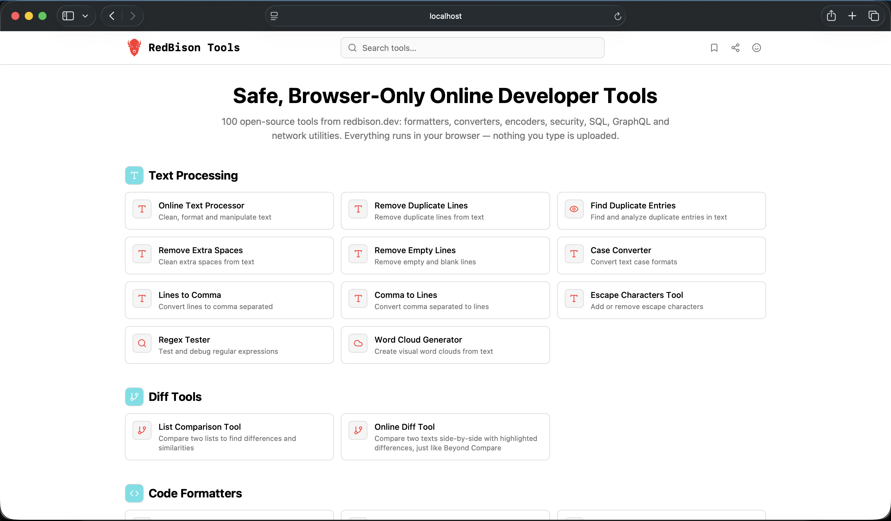
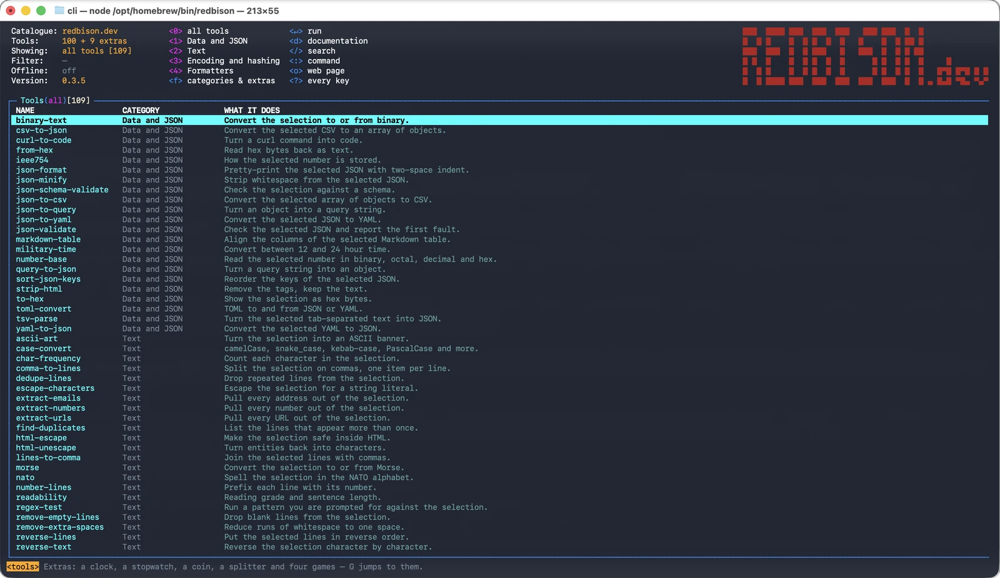

# RedBison Tools

[](https://github.com/redbison-dev/redbison-tools/actions/workflows/ci.yml)
[](https://codecov.io/gh/redbison-dev/redbison-tools)
[](LICENSE)
[](https://buymeacoffee.com/redbison.dev)

**116 free developer tools that run entirely in your browser** — JSON, regex, hashing,
encoders, SQL, GraphQL, network utilities and more. This is the open-source core of
[redbison.dev](https://redbison.dev).



## What this repo is

The top 100 developer tools from redbison.dev, plus the debugging and file-analysis family (heap, thread and GC analyzers, HAR, SQLite, pcap, Arrow, executables, fonts and the binary decoders), as a standalone React app: the tool
components, their logic and their tests, with a minimal home page that lists everything.
No analytics, no accounts, no ads — every tool does its work client-side, so nothing you
type ever leaves your machine. The running site documents the full privacy model,
including what lives in local storage and the complete list of network calls, on its
/privacy page.

The hosted version at **[redbison.dev](https://redbison.dev)** (also reachable via
redbison.tools) carries these same tools plus 500+ more calculators and converters,
guides, multi-language versions and an [MCP server for AI assistants](https://redbison.dev/mcp).

## Why we open-sourced this

Developer utilities handle sensitive material — tokens, keys, connection strings,
customer data — yet most people paste that material into random tools found through a
search, with no way to know what the page actually does with it. A convincing-looking
converter can exfiltrate what you type, and a malicious one looks identical to an honest
one.

We open-sourced these 100 tools so organizations and developers don't have to take that
risk on trust. Here you can **read the code, audit it, and run it yourself** — on
localhost, on your own infrastructure, or behind your firewall. Every tool works
client-side with no telemetry, the full test suite ships with it, and the build is a
static site you control end to end. If your security policy says "no pasting secrets
into unknown websites", this repo is the alternative: the same tools, with nothing
hidden.

## Tools included

Text processing, diff and list comparison, code formatters (SQL, HTML, CSS, JS, XML,
YAML), data conversion (JSON ⇄ YAML/CSV/TypeScript, Markdown ⇄ HTML, XML → JSON, TOML,
cURL → code), security (hashing, HMAC, AES, RSA/EC keys, JWT, TOTP, X.509, SAML,
passwords), SQL and database design tools, GraphQL tooling, an API tester, network
utilities (subnet calculator, DNS, IP tools), binary/data-format tools (hex editor,
protobuf, Avro, Parquet, compression), time tools, and web/devops helpers (cron
expressions, .gitignore, chmod, Docker compose).

**[TOOLS.md](TOOLS.md)** lists every tool with its description, a link to its source
file, and a link to try it on the hosted site.

## About RedBison

[RedBison](https://www.redbison.dev) is a serverless, browser-based ecosystem of over
600 free developer utility tools, converters and specialized calculators, built for
professional speed and privacy. Tools execute entirely client-side on your device —
whether you're generating keys, converting formats, manipulating JSON or using the
[MCP endpoints for AI assistants](https://redbison.dev/mcp), your data stays local and
never leaves your screen.

**Core principles:**

- **Privacy first** — 100% client-side execution for most tools.
- **Frictionless utility** — zero ads, zero pop-ups, zero sign-ups.
- **Comprehensive scope** — from deep developer utilities and encoding tools to
  advanced calculators for finance, health, engineering and mathematics.

Built for engineers and professionals who need reliable, fast utilities without the
bloat. This repo is its open-source core.

## Run it locally

```sh
# bun (recommended)
bun install
bun run dev

# or npm
npm install
npm run dev
```

Open http://localhost:5173. Production build: `bun run build` (output in `dist/`), then
`bun run preview` to serve it.

## Host it yourself

The build is a fully static site — host `dist/` anywhere: GitHub Pages, Netlify, Vercel,
Cloudflare Pages, an S3 bucket or any web server. One note: routes are client-side, so
configure your host to serve `index.html` for unknown paths (Netlify: a `/* /index.html 200`
redirect; GitHub Pages: a `404.html` copy of `index.html`).

## Command line

The same tools as a terminal program, in [`cli/`](cli). 100 commands, 89 of which run
entirely on your machine and never open a socket; the other 11 each need a library too
large to bundle or a data set that changes without us, so they call the hosted MCP
endpoint and say so in their `--help`.

Run it with no arguments and you get a full-screen picker: type to search, `↵` to run,
`d` for the docs, `y` to copy the answer (or the command when there is no answer yet).



```sh
cd cli && bun install && bun run build
./dist/index.js                     # the picker
./dist/index.js --list              # every tool, and whether it is local
echo '{"b":1,"a":2}' | ./dist/index.js json-format
./dist/index.js hash --algorithm sha256 hello
./dist/index.js --offline js-beautify 'var a=1'  # refuse rather than send anything
```

Published as [`@redbison/cli`](https://www.npmjs.com/package/@redbison/cli), which
installs it as both `redbison` and `rb`:

```sh
npm install -g @redbison/cli
rb uuid
```

Reads standard input and writes standard output, so it composes with everything else in
a pipeline. `--offline` makes the network tools refuse rather than send — useful when
the input is a secret. Tests: `cd cli && bunx vitest run`.

## AI assistants (MCP)

The repo ships a local [MCP](https://modelcontextprotocol.io) server (`src/mcp/server.ts`,
no SDK, no network, no telemetry) that exposes a curated set of the tools — case
conversion, regex testing, hashing, JSON/YAML/CSV conversion, Base64, binary/hex, epoch,
JWT decoding, cron explanations, number bases, Markdown→HTML — to any MCP client over stdio:

```sh
bun run mcp        # or: npx tsx src/mcp/server.ts
```

Register it with Claude Code:

```sh
claude mcp add redbison-tools -- bun run /path/to/redbison-tools/src/mcp/server.ts
```

or in Claude Desktop's `claude_desktop_config.json`:

```json
{ "mcpServers": { "redbison-tools": { "command": "bun", "args": ["run", "/path/to/redbison-tools/src/mcp/server.ts"] } } }
```

Full documentation — every tool with its arguments and examples, registration snippets
for each client, and how to add a tool — is in [src/mcp/README.md](src/mcp/README.md).
Prefer zero setup? Use our hosted MCP server instead: endpoint `https://mcp.redbison.dev`
(90+ tools, docs at [redbison.dev/mcp](https://redbison.dev/mcp)). Guides:
[setting up MCP servers in AI clients](https://redbison.dev/blog/how-to-set-up-mcp-servers-in-ai-clients) ·
[building your own MCP server](https://redbison.dev/blog/how-to-build-an-mcp-server).

## Tests and coverage

```sh
bun run typecheck      # TypeScript
bun run test           # unit + integration (every tool page is mounted and must render)
bun run test:coverage  # coverage report (v8), also printed in CI on every PR
```

The suite is 2,000+ tests: unit tests covering the tool logic in `src/lib/tools`, and an
integration suite that mounts all 100 tool routes through the real router and fails if any
page stops rendering. Coverage currently sits at ~64% lines / ~62% statements, with floors
enforced in `vitest.config.ts` so it can only go up. CI runs all of this on every push and
pull request and uploads coverage to Codecov (badge above).

## Found a bug?

**Please [open an issue](https://github.com/redbison-dev/redbison-tools/issues).** Include
the tool, the input that misbehaved and what you expected — tool correctness reports are
treated as top priority. Security-sensitive reports: please use GitHub's private
vulnerability reporting instead of a public issue.

## Contributing

Contributions are welcome — fixes, new tools, tests, docs. See
[CONTRIBUTING.md](CONTRIBUTING.md) for the dev setup and contribution policy,
[ARCHITECTURE.md](ARCHITECTURE.md) for the code organization and tool categorization,
and [CODE_OF_CONDUCT.md](CODE_OF_CONDUCT.md) for conduct expectations. You are also free
to fork and host your own copy under the MIT license.

## Support this project

These tools are free, ad-free and will stay that way. If they saved you some time and
you'd like to say thanks, you can [buy me a coffee](https://buymeacoffee.com/redbison.dev).
Entirely optional: bug reports and pull requests are just as welcome, and often more useful.

## License

[MIT](LICENSE). The RedBison name and logo identify the upstream project; if you publish
a substantially modified fork, please use your own name for it.
