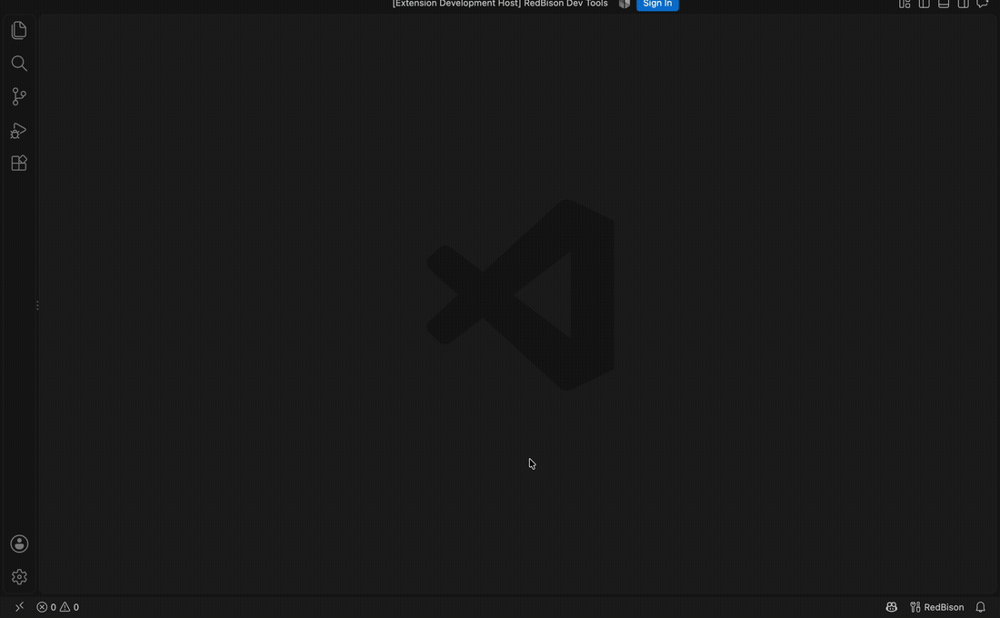
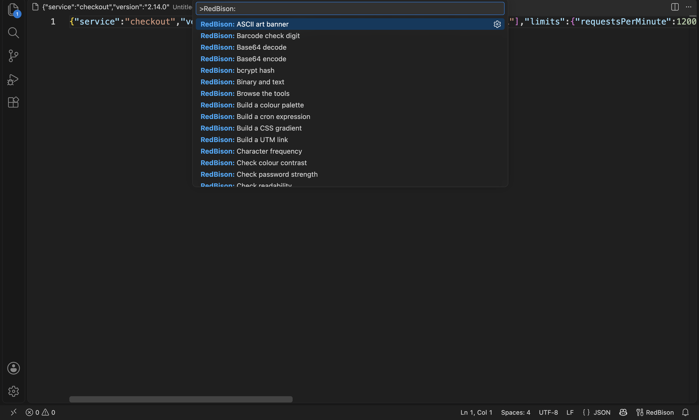
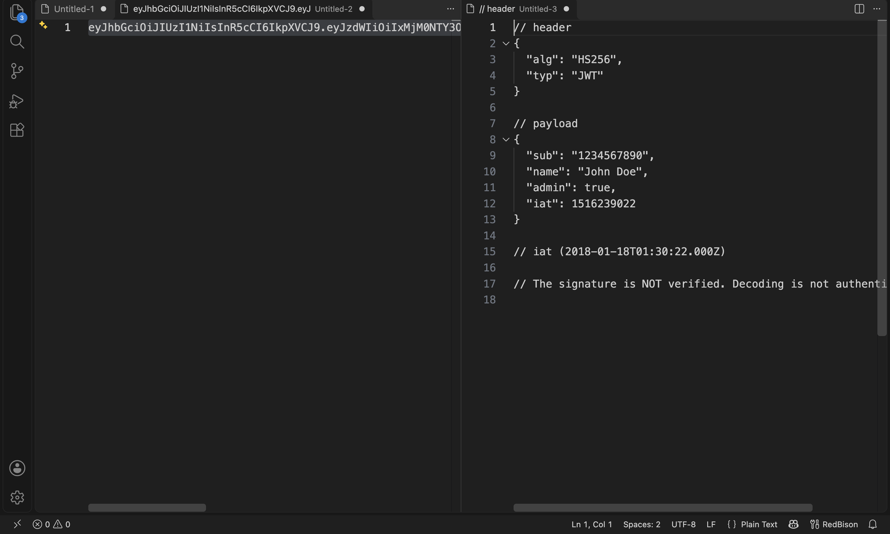

# RedBison Dev Tools

A hundred and nine everyday developer tools on the current selection,
without leaving the editor. Ninety-eight of them never touch the network.

Select some text, press **Ctrl+Shift+P** and type *RedBison*, or right-click
and pick **RedBison**. A transform replaces the selection as a single undo
step. An inspection opens the result beside your file and leaves the file
alone.

## What it does

**Format and convert** — JSON (format, minify, validate, query), YAML ↔ JSON,
CSV ↔ JSON, TOML, SQL, HTML, XML, JavaScript, CSS, Markdown tables,
curl → code, `docker run` → Compose.

**Encode and hash** — Base64, URL percent-encoding, HTML entities, binary and
hex, MD5/SHA-1/SHA-256/SHA-512, HMAC with a webhook preset, bcrypt, JWT decode.

**Look up** — HTTP status codes, MIME types, cron expressions in plain words,
epoch timestamps, time zones, number bases, user agents, regular expressions
against your selection.

**Text** — change case, slugify, sort, de-duplicate, wrap, join and split
lines, count words, diff two blocks, readability.

**Colour and design** — convert between hex/RGB/HSL, contrast against WCAG,
build a palette or a CSS gradient.

**Insert** — a UUID, a strong password, placeholder text, a `.gitignore`,
ASCII art, redirect rules.

Run **RedBison: Browse the tools** for the full list with descriptions, or
**RedBison: Tool options** to set a tool's arguments before it runs.

## Offline

**Ninety-eight of the hundred and nine need no network.** Anything built on Node's own
crypto, a JSON parser or string handling runs in the editor: hashing, HMAC,
Base64, URL and HTML encoding, JWT decode, UUIDs, passwords, case conversion,
line operations, number bases, epoch conversion, regex testing, HTTP status
and MIME lookups and more. The palette marks the rest with a cloud.

The other thirty-five call [redbison.dev](https://redbison.dev)'s public
endpoint, because they need a library too large to ship inside an editor
extension — the zxcvbn dictionaries, ajv, js-beautify, a cron parser. It is
the same code the website runs, so there is one implementation and a fix on
the site reaches you without an update.

## Privacy

A command sends only the text you selected, and only when you run it. Nothing
is sent in the background, nothing is stored, there is no telemetry and no
account. The ninety-eight offline commands send nothing at all.

## Also available

- **Terminal** — the same hundred tools as a CLI:
  `npm install -g @redbison/cli`, then `redbison` or `rb`.
  [redbison.dev/cli](https://redbison.dev/cli)
- **JetBrains** — the same list, generated from the same source, so a tool is
  never in one editor and missing from the other.
- **The web** — every command can open its full tool page in a browser; some
  are better with a UI than a one-shot answer.
  700+ free tools at [redbison.dev](https://redbison.dev).

## Open source

MIT licensed, built in the open:
[github.com/redbison-dev/redbison-tools](https://github.com/redbison-dev/redbison-tools)

## In the editor

